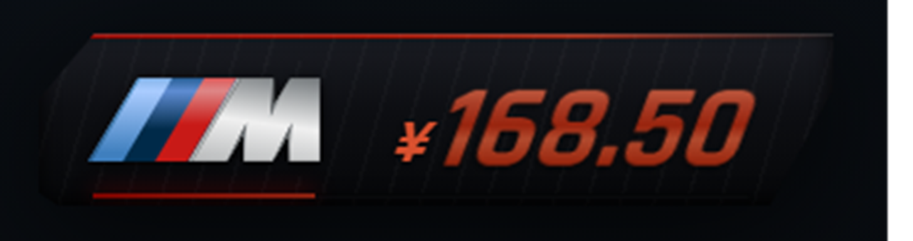
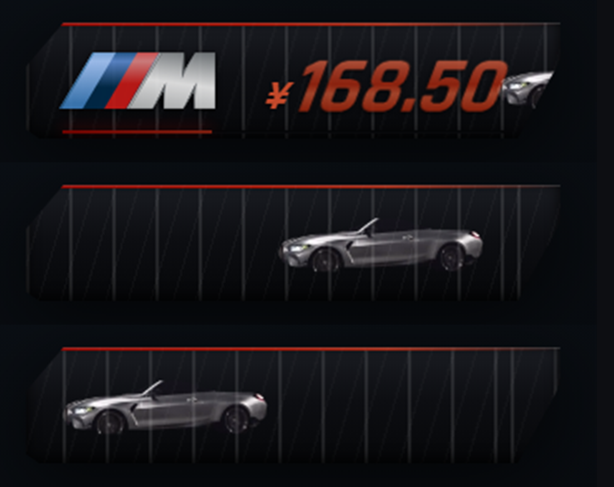

# dsh-corner-gauge

[](https://github.com/kkppshuai-svg/dsh-corner-gauge/actions/workflows/ci.yml)
[](LICENSE)
[](package.json)

给 [DeepSeek Harness](https://github.com/deepseek-ai) 用的角落悬浮面板：**显示账户余额**。

外形是一块斜切底板，右侧是金属质感的数字。
**边框是模板（skin），面板里显示什么由元素（elements）决定**——换壳、加减元素都不必动另一层。



---

## 目录

- [特性](#特性)
- [安装](#安装)
- [配置](#配置)
- [自定义边框模板](#自定义边框模板)
- [自定义面板元素](#自定义面板元素)
- [数据快照](#数据快照)
- [开发](#开发)
- [已知限制](#已知限制)
- [项目](#项目)

---

## 特性

- **边框可换**：内置 `mclaren`（斜切 + 品牌标志）与 `minimal`（极简圆角）
- **车辆 ↔ 品牌联动**：M4 显示宝马 M 标志与红色饰条，迈凯伦显示 speedmark（金属镀铬质感）与 papaya 橙
- **元素可插**：货币符号、金额、进度条各自独立，按 `config.elements` 顺序装配
- **零外部请求**：字体与标志全部 base64 内嵌，离线可用（CI 会校验）
- **可拖动**：位置写入 localStorage，窗口缩放自动钳制回视口
- **不崩界面**：取数失败按指数退避重试；未登录 / 不可用时显示 `--`，不会静默消失
- **彩蛋**：单击面板，一辆 M 跑车从右向左开过一次（期间只显示跑车），
  配 M4 直六声浪（参考录音内嵌，另有 WebAudio 合成器兜底），右上角喇叭按钮可开关声音

---

## 安装

### 1. 放进 profile

```bash
# 把仓库复制进 profile 的 node_modules
# Windows 示例
xcopy /E /I dsh-corner-gauge "%USERPROFILE%\.dsh\profiles\desktop\node_modules\dsh-corner-gauge"
```

### 2. 登记到 profile

`~/.dsh/profiles/<profile>/package.json`：

```json
{
  "dependencies": {
    "dsh-corner-gauge": "^2.0.0"
  },
  "dsh": {
    "profile": {
      "bundles": [
        "...",
        "dsh-corner-gauge"
      ]
    }
  }
}
```

### 3. 重启 App

客户端插件的 bundle 在启动时构建，**改完必须重启**（刷新页面不够）。

> 启动后插件没出现，先检查 `dsh.profile.bundles` 里是否还留着它——
> DSH 在 profile 组合失败时会重置配置。

---

## 配置

运行时覆盖，在插件加载前塞一个全局对象：

```js
window.__DSH_BADGE_CONFIG__ = {
  skin: 'mclaren',
  elements: ['currency', 'amount', 'progress'],
  position: { right: 22, bottom: 96 },
  size: { width: 322, height: 70 },
  currency: 'auto',          // 'auto' | 'CNY' | 'USD'
  pollMs: 60000,
};
```

| 键 | 类型 | 默认 | 说明 |
|---|---|---|---|
| `skin` | `string` | `'mclaren'` | 边框模板名 |
| `elements` | `string[]` | `['currency','amount','progress']` | 面板元素顺序 |
| `position` | `{right,bottom}` | `{22,96}` | 默认停靠位置 |
| `size` | `{width,height}` | `{322,70}` | 面板尺寸（px） |
| `currency` | `string` | `'auto'` | 币种，`auto` 跟随账户 |
| `pollMs` | `number` | `60000` | 轮询间隔（毫秒） |
| `drive.enabled` | `boolean` | `true` | 是否启用点击跑车彩蛋 |
| `drive.sound` | `boolean` | `true` | 声浪默认开关（用户切过以用户为准） |
| `drive.durationMs` | `number` | `1500` | 跑车穿过面板的时长 |
| `drive.fx` | `boolean` | `false` | 是否叠加速度线与拖尾特效 |
| `drive.car` | `string` | `'auto'` | `'auto'` 每次点击换下一辆；也可填固定车辆 id |

---

## 素材库

所有车辆都在 `assets/manifest.json` 里声明，**构建时整体内嵌进产物**（仍是零外部请求）。

```json
{
  "cars": [
    { "id": "bmw-m4-gt3", "name": "BMW M4 GT3 · 赛车涂装", "kind": "alpha", "file": "cars/bmw-m4-gt3.webp", "sound": "engine-m4" },
    {
      "id": "mclaren-f1", "name": "McLaren F1 · 迈凯伦", "kind": "alpha",
      "file": "cars/mclaren-f1.webp", "sound": "engine-m4",
      "wheels": [
        { "file": "cars/mclaren-wheel-front.webp", "x": 22.29, "y": 71.47, "d": 12.24 },
        { "file": "cars/mclaren-wheel-rear.webp",  "x": 86.29, "y": 72.39, "d": 12.24 }
      ]
    }
  ],
  "sounds": [
    { "id": "engine-m4", "name": "M4 直六 · 近距实录", "file": "sounds/engine-m4.mp3" }
  ]
}
```

`kind` 决定在面板上怎么融进深色刀锋：

| kind | 含义 | 渲染方式 |
|---|---|---|
| `cutout` | 透明底（或黑底可被过滤）的抠图 | `mix-blend-mode: screen`，黑底自动消失 |
| `plate` | 带柔化透明边的场景照片 | 正常混合，边缘自己淡出 |
| `alpha` | 带真实透明通道的抠图（如白底抠干净的车） | 正常混合 |

### 一键入库：`npm run import`

把图片丢进 `assets/incoming/`，然后：

```bash
npm run import            # 批量处理整个 incoming 目录
npm run import -- --wheels      # 顺便打印车轮候选坐标
npm run build             # 重新打包
```

单张也可以：

```bash
node scripts/import-car.mjs \
  --file assets/incoming/mclaren.png \
  --id mclaren-f1 --brand mclaren --sound engine-f1 \
  --wheels "22.29,71.47,86.29,72.39,12.24"
```

`--wheels` 的格式是 `前轮x,前轮y,后轮x,后轮y,直径`，坐标和直径都是**相对车身的百分比**。
不给 `--wheels` 就不生成车轮（车照样跑，只是轮子不转）。

入库时会自动做完整套处理：

| 步骤 | 作用 |
|---|---|
| 包围盒裁剪 | 去掉四周空白 |
| 白底泛洪 | 只删与画面边界连通的白区，车身内部浅色不受影响 |
| 反预乘 | `C' = (C − (1−a)·255)/a`，去掉半透明边缘的白边 |
| 边缘蚀刻 | 接触透明的像素 alpha 减半，轮廓收缩 1px |
| 底部反光压制 | 下半区 `luma > 190` 的影棚反光淡出（这是白边的主要来源） |
| 距离场轮廓压暗 | 3px 以内的车身边缘按 35%→100% 压暗，消除亮边 |
| 底部渐隐 | 最后 18% 高度平方曲线收尾，去掉地面倒影 |

**素材要求**（很重要）：

- **侧视图**，不是 3/4 透视照（透视车在横向跑动的面板里会明显错位）
- **纯白或透明背景**，车身本身不要有浅灰投影
- 长边 1000px 以上即可，脚本会自动缩到 660px 宽

### 车辆 ↔ 品牌

每辆车在清单里用 `brand` 指定品牌，跑车时面板的标志与强调色会跟着切换：

```json
{ "id": "m4-silver", "brand": "bmw-m", "sound": "engine-m4" }
{ "id": "mclaren-f1", "brand": "mclaren", "sound": "engine-f1" }
```

| brand | 标志 | 强调色 |
|---|---|---|
| `bmw-m` | 宝马 M 三色标（原图直出） | 宝马红 `#b00500` |
| `mclaren` | 迈凯伦 speedmark（蒙版 + 镀铬渐变） | papaya 橙 `#ff8000` |

单色标会在品牌表里标 `metal: true`，用「图形当蒙版 + 金属渐变填充」渲染出镀铬质感。

### 声浪与 BGM

`sounds` 里可以放任意音频，车辆用 `sound` 指向它。普通引擎声浪 1.6–1.8 秒；
如果是音乐类（BGM），给车辆加 `durationMs`，让跑车动画和音乐同长：

```json
{ "id": "redbull-rb20", "sound": "bgm-verstappen", "durationMs": 2600 }
```

#### 用你自己的 BGM（本地覆盖，不进仓库）

仓库自带的 `bgm-verstappen.mp3` 是项目用合成器做的"人浪"（`_tools/chant.mjs`）——
商业音轨（例如 Pitstop Boys 的《Super Max》）有版权，不能放进公开仓库。

想换成你本机上的版本，一条命令：

```bash
node _tools/set-bgm.mjs "C:\path\to\track.mp3" --start 12.5 --dur 2.6
npm run build
```

脚本会截取、归一化并写入 `assets/sounds-local/bgm-verstappen.mp3`；
构建时这个目录**优先于**仓库素材，而它已在 `.gitignore` 里，所以不会推到 GitHub。
删掉该文件再构建即恢复默认合成版。

### 提交前必读

交付到仓库的产物必须用「不带本地覆盖」的方式构建，否则 CI 会因为产物与源码不一致而失败：

```bash
npm run build                 # 干净构建（不含本地版权声浪）→ 提交这份 lib/client.js
node scripts/build.mjs --local --out "<插件安装目录>/lib/client.js"
                              # 带本地 BGM，只写进安装目录，不进仓库
```

## 数据源适配（DSH / Codex / Claude Code / 豆包）

面板不再只认 DSH 账户余额。配置里的 provider 决定它显示谁的数据：

| provider | 数据来源 | 显示 |
|---|---|---|
| dsh（默认） | ctx.remote.account.getBalance | ¥ 余额 |
| codex | ~/.codex/sessions/**/*.jsonl 里的 	oken_usage_record | Token 用量（紧凑写法，如 112.8M）|
| claude | ~/.claude/projects/**/*.jsonl 里 assistant 消息的 usage | Token 用量 |
| doubao | ~/.doubao/usage.json（自己写，或用火山引擎 API 产出）| Token 用量 |

面板装在浏览器环境里读不到本机文件，所以由**本地桥接**收集：

```bash
npm run bridge                 # 启动后监听 http://127.0.0.1:7317
npm run bridge:once -- --provider codex --period week   # 只打印一次结果，不常驻
```

面板每 pollMs 拉一次 /usage?provider=codex&period=today。桥接没启动时面板显示 --，不会报错。

period 可选 	oday / week / month / ll。

配置示例：

```json
{
  "provider": "codex",
  "period": "week",
  "bridgePort": 7317,
  "pollMs": 120000
}
```

数据源只能在配置里选（`provider` 字段）。面板上的 ⚙ 菜单**只负责换车**，不再混入数据源选项。

### 豆包怎么接

豆包客户端不落本地用量日志（%APPDATA%\Doubao 里只有一个 public_config.json），所以按三级回退：

| 优先级 | 方式 | 说明 |
|---|---|---|
| ① | VOLC_ACCESSKEY + VOLC_SECRETKEY | 调火山引擎费用中心 QueryBalanceAcct，拿账户可用余额（¥）。程序内置 HMAC-SHA256 签名，无需额外依赖 |
| ② | DOUBAO_USAGE_URL | 指向任意返回 {"value":12.3,"unit":"CNY"} 或 {"value":1234567,"unit":"tokens"} 的 HTTP 接口 |
| ③ | ~/.doubao/usage.json | 同上格式的本地文件，自己用脚本产出 |

```bash
# 例：用火山引擎 AK/SK（在个人中心 → 密钥管理 创建，需要费用中心读权限）
="AKLT..."
="..."
npm run bridge
```

```json
// ~/.doubao/usage.json
{ "value": 42.75, "unit": "CNY", "label": "豆包余额" }
```

面板会按 unit 自动切换显示方式：CNY 显示成 ¥42.75，	okens 显示成 42.8M。

### 采集口径

- **Codex**：按行流式扫描会话 JSONL（单文件可能上百 MB），只累加时间戳在区间内的 payload.usage；input_tokens + output_tokens 作为总数，明细里还保留 cached / reasoning / turns。
- **Claude Code**：只统计 message.usage 存在的 assistant 条目，同样是 input + output；cache 读写单独记录。
- **豆包**：目前没有公开的本地会话日志格式，走 ~/.doubao/usage.json 这个约定文件；要接火山引擎 OpenAPI（AK/SK 签名）可以在此基础上扩。

> 桥接只监听 127.0.0.1，不出网；erify 脚本也只放行 localhost 地址，其他外部 URL 依然会判失败。


### 车轮滚动

车辆条目里可以带 `wheels`：跑动时按车身百分比定位圆形车轮图层，绕自身圆心旋转。

| 字段 | 说明 |
|---|---|
| `x` / `y` | 车轮中心相对车身的百分比坐标 |
| `d` | 车轮直径，相对车身**宽度**的百分比 |
| `speed` | 转一圈的秒数（默认 0.16，越小越快） |

**加一辆车**：把图片丢进 `assets/cars/`，在清单里加一条，`npm run build` 即可 —— 不用改 JS。
**换声浪**：把 mp3 丢进 `assets/sounds/`，清单 `sounds` 加一条，车辆的 `sound` 指向它即可。

### 声浪：录音优先，合成兜底

`drive.engine` 控制声浪来源：

| 值 | 行为 |
|---|---|
| `'auto'`（默认） | 优先播放清单里的录音，没有录音时回退到 WebAudio 合成 |
| `'sample'` | 只用录音 |
| `'synth'` | 只用实时合成（直列六缸谐波堆叠，见 `src/35-drive.js`） |

合成器按四冲程直列六缸建模（点火频率 `f = rpm/20`），转速曲线
`1500 → 7300 → 2300`，配低通扫频、失谐谐波、排气噪声与收油回火。
`engine.revScale` / `engine.roar` 可按车微调。

`drive.car` 默认 `'auto'`：清单里有多辆车时点一次换一辆；只有一辆时始终是它。

---

## 彩蛋：跑车

**单击面板**（不拖动），一辆 M 跑车从右向左开过一次：

- 车辆来自上面的素材库，默认按 `auto` 轮换
- 跑动期间面板元素、边框标志、进度线、斜向流动纹全部隐藏，只留跑车本体
- **右上角喇叭按钮**开关声音，状态写进 `localStorage`，下次启动保持
- 拖动与单击互斥：指针位移 < 6px 且短于 400ms 判定为单击；点喇叭不会误触发跑车

```js
window.__DSH_BADGE_CONFIG__ = {
  drive: { enabled: true, sound: true, durationMs: 1500, fx: false, car: 'auto' },
};
```



---

## 自定义边框模板

模板只负责**外壳**：形状、底色、装饰、标志。它不关心面板里显示什么。

```js
BADGE.skins['my-skin'] = {
  // 样式：id 是面板根节点 id
  css(id) {
    return `
#${id} .g-blade {
  position: absolute; inset: 0;
  clip-path: polygon(0 20%, 6% 0, 100% 0, 100% 100%, 0 100%);
  background: linear-gradient(180deg, #1a1c22, #060709);
}`;
  },

  // 装饰节点（可选）：往外壳里塞 DOM
  build(blade) {
    const dot = document.createElement('div');
    dot.className = 'g-dot';
    blade.appendChild(dot);
  },
};
```

然后 `config.skin = 'my-skin'`。

| 内置模板 | 说明 |
|---|---|
| `mclaren` | 斜切底板 + 品牌标志（随车辆切换）+ 顶部品牌色条 + 斜向速度线 |
| `minimal` | 极简圆角底板，无装饰 |

---

## 自定义面板元素

元素只负责**显示什么**。

```js
BADGE.elements.delta = {
  css(id) {
    return `#${id} .g-delta { font-size: 13px; color: #4ade80; }`;
  },

  // 挂载：返回自己的节点。parts = { root, blade, content }
  mount(parts) {
    const el = document.createElement('span');
    el.className = 'g-delta';
    parts.content.appendChild(el);
    return el;
  },

  // 数据变化时刷新
  update(el, view) {
    el.textContent = view.state === 'ready' ? '▲' : '';
  },
};
```

写进配置：`elements: ['currency', 'amount', 'delta', 'progress']`。

| 内置元素 | 说明 | 默认 |
|---|---|---|
| `currency` | 币种符号（¥ / $） | 开 |
| `amount` | 金额数字（金属渐变） | 开 |
| `progress` | 底部进度条，按量程自动缩放 | 开 |

---

## 数据快照

`update(el, view)` 里的 `view`：

```js
{
  state: 'loading' | 'ready' | 'guest' | 'error',
  total: 168.5,        // 充值余额 + 同币种赠金
  currency: 'CNY',
  scaleMax: 200,       // 进度条量程
}
```

余额来自 `ctx.remote.account.getBalance(metadata)`，`metadata` 需要
`{ version, locale, timezoneOffsetSeconds }`，版本号必须与运行时一致。

---

## 开发

只需要 Node.js ≥ 18，**没有任何第三方依赖**。

```bash
npm run build      # src/ + assets/ → lib/client.js（base64 内嵌）
npm run lint       # 语法、命名约定、占位符残留、命名空间引用
npm run verify     # 重新构建并与仓库产物逐字节比对
npm test           # lint + verify
```

双击 `preview.html` 即可查看效果——它用假的 `ctx.remote` 喂数据，
与装进 App 后运行的是同一份渲染代码。

### 目录结构

```
src/
  00-config.js     配置、常量、view 快照
  10-data.js       取数、格式化、诊断遥测
  20-drag.js       拖动与位置记忆
  30-skins.js      边框模板注册表（外壳）
  40-elements.js   面板元素注册表（内容）
  50-render.js     装配：样式汇总、建 DOM、绘制、重试
  60-client.js     插件入口 apply()
assets/
  manifest.json    素材库清单（车辆）
  cars/            车辆图片（cutout 或 plate）
  sounds/          声浪录音（构建时内嵌，可留空走合成）
  mclaren-mark.webp  迈凯伦标志（构建时 base64 内嵌）
  rajdhani-700.woff2  字体（构建时 base64 内嵌）
scripts/           build / verify / lint
lib/               构建产物：index.js（宿主半边）+ client.js（浏览器半边）
```

> `lib/client.js` 由构建生成，**不要手改**——CI 会校验产物与源码是否一致。

---

## 已知限制

- 客户端插件在 DSH 启动时装配，改完必须重启，热更新不生效
- 余额依赖 `ctx.remote.account.getBalance`，需要先在 DSH 里登录账户；
  纯 API Key 模式拿不到余额，面板会一直显示 `--`
- 配色与字号写在 `src/40-elements.js` 的 CSS 里，换主题请改源码后重新构建

---

## 项目

| 文档 | 说明 |
|---|---|
| [CHANGELOG.md](CHANGELOG.md) | 版本变更记录 |
| [CONTRIBUTING.md](CONTRIBUTING.md) | 开发流程、提交规范、PR 要求 |
| [SECURITY.md](SECURITY.md) | 安全边界与漏洞报告方式 |

## 许可

MIT。内置的 M 标志来自 [Wikimedia Commons](https://commons.wikimedia.org/wiki/File:BMW_M_logo.svg)，
相关商标归 BMW AG 所有，仅作为个人主题资源使用，本项目与 BMW 无关联。
字体 [Rajdhani](https://fonts.google.com/specimen/Rajdhani) 采用 SIL OFL 1.1。
